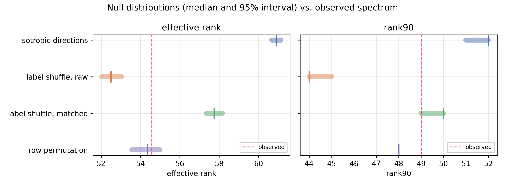

# Geometry of GO label probes in ESM-2 protein embeddings

Do linear probes for different Gene Ontology labels learn *shared* directions in a
protein language model, and if so, does that mean the model stores features in
superposition?

This repository answers those questions for 75 GO Cellular Component (GO CC) labels
and 9,895 protein sequences embedded with ESM-2. It contains the full analysis
notebook, the data-preparation notebook, the report (LaTeX), every figure it
references, and the machine-readable results file.

## The result in one paragraph

The 75 probe weight vectors are linearly independent (rank 75 of 75), with no
near-collinear pair: the largest absolute cosine between any two label directions is
0.418, an angle of 65 degrees. Their spectrum is moderately concentrated - 90% of the
energy sits in 49 of the 75 directions, and the effective rank is 54.54. That
concentration is **not** evidence of superposition: a null model that keeps the
co-occurrence structure of the GO labels but breaks their pairing with the proteins
reproduces the observed spectrum almost exactly (effective rank 54.32, p = 0.73),
while nulls that destroy the label structure do not. The geometry is inherited from
the redundancy of the annotation, and with 75 labels in 480 dimensions there is no
capacity pressure that would require superposition in the first place.



The same conclusion appears per pair: weight-vector similarity tracks label
co-annotation (Spearman 0.507, partial 0.489 after controlling for co-occurrence),
so the directions are semantically meaningful, but their global concentration is a
property of the labels rather than of the sequence representation.

## What is in this repository

| Path | What it is |
| --- | --- |
| `protein_go_geometry.ipynb` | **Main analysis**, executed end to end. Starts from the cached arrays and produces every number and figure in the report. About 11 min on CPU. |
| `Protein.ipynb` | Data preparation: UniProt download, GO parsing, label selection, ESM-2 embeddings. Needed only to rebuild `protein_dataset/`. |
| `main.tex` | The report, ready for Overleaf. Compiles with `figures/` next to it. |
| `figures/` | The five figures used by the report (250 dpi, written by the analysis notebook). |
| `results.json` | Every headline number, written by the analysis notebook. |
| `protein_dataset/` | Small label tables (committed) and the embedding arrays (regenerated, see below). |
| `paper_code_map.md` | Traceability notes: which cell produces which claim in the report. |
| `requirements.txt` | Python dependencies. |

## Data

The dataset is a 10,000-record prefix of reviewed Swiss-Prot, downloaded from the
UniProt REST API. Proteins without a GO CC annotation are dropped (9,895 remain),
and the 75 GO CC terms present in at least 100 proteins are kept as labels.

| Quantity | Value |
| --- | --- |
| Protein records | 9,895 |
| Embedding dimension (ESM-2 `esm2_t12_35M_UR50D`, layer 12, mean-pooled) | 480 |
| Labels | 75 |
| Positive label assignments | 36,188 |
| Mean labels per protein | 3.66 |
| Distinct GO CC terms in the export | 1,779 |

The embedding arrays and the 94 MB UniProt FASTA are **not** committed:

* `protein_dataset/*.npy` (`esm2_embeddings.npy`, 19 MB; `go_labels.npy`, 3 MB) are
  rebuilt by `Protein.ipynb` in about 45 minutes on CPU.
* `protein_dataset/uniprot_swissprot_go_cc.csv` (7.9 MB, the source table) **is**
  committed, so the labels can be rebuilt without network access.

If you only want to read the analysis, `results.json` and the notebooks contain
everything; no data download is required to follow it.

## Reproducing

```bash
pip install -r requirements.txt

# 1. Rebuild the dataset (optional; needs network and about 45 min on CPU)
jupyter nbconvert --to notebook --execute --inplace Protein.ipynb

# 2. Rebuild every number and figure in the report (about 11 min on CPU)
jupyter nbconvert --to notebook --execute --inplace protein_go_geometry.ipynb
```

Step 2 rewrites `results.json`, `figures/*.png` and
`protein_dataset/probe_weights.npy`. The permutation nulls are deterministic (fixed
seeds), so repeated runs reproduce the same numbers.

## Method at a glance

1. **Probe.** One-vs-rest logistic regression on standardised embeddings, one binary
   classifier per label (`class_weight="balanced"`, `C = 1`), 80/20 split.
   Mean ROC-AUC 0.784, mean average precision 0.223.
2. **Exact geometry (Q1-Q3).** Numerical rank, rank of random row subsets, and a
   collinearity margin `sigma2/sigma1 = sqrt((1-|c|)/(1+|c|))` derived from the
   cosine between two vectors.
3. **Spectrum (Q4).** SVD of the 75 x 480 weight matrix; cumulative energy, Rank90,
   effective rank `exp(entropy)`.
4. **Null ladder.** Four nulls, each preserving a different part of the problem:
   isotropic directions, label-shuffle raw, label-shuffle with matched row norms,
   and row permutation (which keeps label co-occurrence but breaks the protein
   pairing).
5. **Label structure.** Co-occurrence, label correlation, and weight cosine over all
   2,775 label pairs, plus a residualized rank correlation controlling for
   co-occurrence.

## Results

| Quantity | Value |
| --- | --- |
| Rank of `W` | 75 / 75 (tolerance 4.5e-12) |
| Closest pair of directions | `GO:0005789` / `GO:0005783`, abs cos = 0.4177 (65.3 deg) |
| Rank90 / Rank95 | 49 / 57 |
| Effective rank | 54.54 |
| Isotropic null | 60.91 [60.66, 61.14], p < 0.001 |
| Label shuffle, raw | 52.51 [52.04, 53.03], p = 1.000 |
| Label shuffle, row-norm matched | 57.75 [57.36, 58.16], p = 0.005 |
| Row permutation | 54.32 [53.57, 54.98], p = 0.733 |
| Weight cosine vs. label correlation | Spearman 0.5074, partial 0.4889 |

Lower effective rank means a more concentrated spectrum, so a small p-value means
"more concentrated than the null". The row-permutation null is the only one that
lands on the observation.

## Report

`main.tex` is the report. To compile it on Overleaf, upload `main.tex` and the
`figures/` directory to a new project (the repository root already has the right
layout). The analysis in the report is tied to `results.json`, so every number can
be checked against a fresh run of the notebook.

## Authors

Ruixi Ma, Rutgers University - with contributions from Guillaume Lamoureux,
Rutgers University.

```bibtex
@misc{ma2026gogeometry,
  author = {Ruixi Ma},
  title  = {Geometric Structure of GO Label Probes in Protein-Language-Model
            Embeddings: Spectral Concentration Is Explained by Label Co-Occurrence},
  year   = {2026},
  note   = {With contributions from Guillaume Lamoureux, Rutgers University}
}
```

## Notes and limitations

* The dataset is a 10,000-record prefix of reviewed Swiss-Prot, so absolute metrics
  are not comparable across papers.
* A single 80/20 split without homology-aware partitioning; near-duplicate sequences
  may inflate the reported ROC-AUC. The geometry analysis does not depend on the
  split.
* Only layer 12 of the 35M ESM-2 checkpoint, with mean pooling.
* The 2,775 label pairs are not independent, so the reported p-values are
  descriptive rather than inferential.
* Each null preserves a different subset of the problem; the row-permutation null
  describes what the labels alone can produce, and does not prove that the labels
  are the only cause of the observed spectrum.
